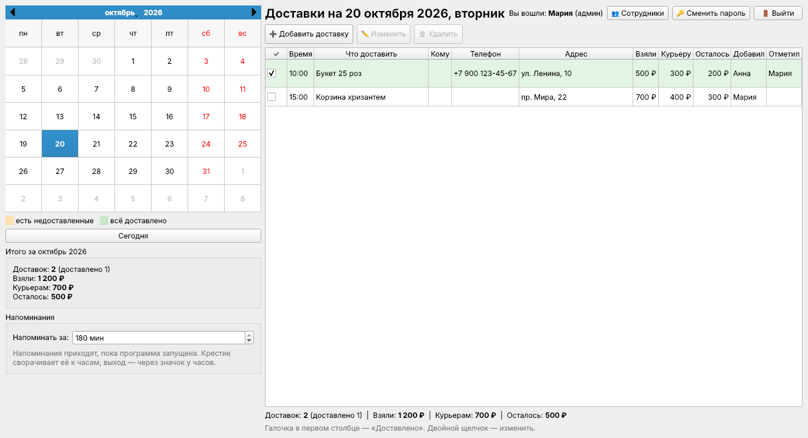

# AloFlorist

Программа для Windows для цветочного магазина: доставки по дням, смены и касса, зарплата, итоги и управление через Telegram.



## Что умеет

- **Календарь на месяц.** Дни с доставками выделены: оранжевым, если что-то ещё не доставлено, зелёным, если доставлено всё.
- **Список доставок на выбранный день**, отсортированный по времени.
- По каждой доставке записываются:
  - дата и время;
  - что доставить (букеты, наполнение, открытка и т.п.);
  - кому: имя (необязательно), телефон, адрес;
  - деньги: **взяли с покупателя**, **отдали курьеру**, **осталось** (= взяли − курьеру, считается само).
- Две галочки прямо в таблице: **💐 «Собрано»** и **✓ «Доставлено»** (доставленный букет считается собранным). Заказ на неделю вперёд собирать заранее не нужно — программа сама скажет, когда пора.
- **«Не собрано!»** За час до доставки (можно поменять), если букет не отмечен собранным, поверх всех окон всплывает окно со звуком: время, что собрать, адрес и кнопка «💐 Собрано». «Напомнить через 10 минут» — и через 10 минут оно появится снова, пока букет не соберут. Если за 30 минут до доставки букет всё ещё не собран и окно висит без ответа уже 10 минут (срочный заказ только что приняли — сначала флорист), администраторам приходит сообщение в Telegram (оба времени — в ⚙ Настройки → Основное; 0 — выключить). В таблице такие строки подсвечены.
- **План на смену.** Сразу после начала смены показывается, что сегодня сделать: доставки смены с отметкой «собрать к 11:00» / «собрано» / «доставлено», сколько заказов на следующие дни (их собирать рано), день ли смены воды и обязанности. Открыть ещё раз — кнопка «📋 План».
- Итоги за день и за месяц: количество доставок, сколько взяли, сколько отдали курьерам и сколько осталось.

- **Напоминания.** За 20 минут до доставки (можно поменять) в углу экрана появляется уведомление Windows: время, что везти и адрес. Время берётся из поля «Время» (для «14:00–16:00» — начало, 14:00). О доставленных не напоминает.
  - Напоминания приходят, пока программа запущена. Крестик не закрывает её, а сворачивает к часам (значок цветка в трее). Полностью выйти — правой кнопкой по значку → «Выход».
  - В **«⚙ Настройки»** можно изменить, за сколько минут напоминать, и включить галочку **«Запускать вместе с Windows»** — тогда программа сама стартует при включении компьютера (свёрнутой) и будет напоминать.

- **Профили сотрудников.** Вход по логину и паролю. В таблице, в столбце «Кто», видно, кто добавил доставку и кто отметил её доставленной (✓). Смена пароля — в меню под своим именем вверху.
  - При первом запуске программа попросит создать администратора — это главный профиль.
  - Администратор в **«⚙ Настройки» → «Сотрудники…»** добавляет и удаляет сотрудников, сбрасывает им пароли и может назначить другого администратора.
  - Каждый может сменить свой пароль. Кнопка **«Выйти»** — чтобы за компьютер сел другой сотрудник.
  - Пароли не хранятся в открытом виде. Если сотрудник забыл пароль — администратор задаёт ему новый. Совет: заведите двух администраторов, чтобы не остаться без доступа.

- **Сообщения заказчику.** В доставке указывается, откуда заказ (WhatsApp, Telegram, ВКонтакте, Макс…), и контакт заказчика. Кнопка **«💬 Написать заказчику»** предлагает три готовых сообщения: «Курьер выехал», «Букет доставлен», «Просьба об отзыве». Когда вы ставите галочку «Доставлено», программа сама предложит написать заказчику.
  - **WhatsApp** (по номеру) и **Telegram** (по логину `@имя`): открывается чат с уже вставленным текстом, остаётся нажать «Отправить».
  - **ВКонтакте, Макс и остальное:** эти мессенджеры не дают подставить текст по ссылке. Программа копирует текст в буфер (и открывает страницу, если указана ссылка), а вы вставляете его через `Ctrl+V`.
  - В столбце «Писали» видно, какие сообщения уже отправляли. Отметка ставится при нажатии кнопки, то есть программа не знает, нажали ли вы потом «Отправить» в мессенджере.
  - Администратор может поменять тексты сообщений: **«⚙ Настройки» → «Тексты сообщений…»**.

- **Автообновление.** Программа сама проверяет новые версии при запуске и раз в 6 часов. Нашла — спросит «Обновить сейчас?», скачает новый файл, проверит его целостность, заменит себя и перезапустится. Записи, сотрудники и настройки остаются на месте: они хранятся не в `.exe`, а в папке «Документы\\Доставки цветов» и в настройках Windows. Перед обновлением рядом с базой кладётся копия `deliveries.before-update.db`. Вручную проверить можно в **«⚙ Настройки» → «Проверить обновления»**.

- **Смены и касса.** Магазин работает круглосуточно, пересменка в 8:00 (меняется в настройках).
  - **Вход в смену.** Сотрудник после входа пересчитывает наличные и вводит сумму. Программа сверяет её с тем, что оставила прошлая смена, и показывает расхождение.
  - **Во время смены** — кнопка «💸 Расход / изъятие»: расход из кассы (на что потратили) или изъятие (кто забрал деньги).
  - **Сдача смены** — кнопка «🔴 Сдать смену». Слева — выручка: **Приход** (вся сумма за смену), **Цветы**, **Терминал**, **QR-код**, **Продажи наличными** и деньги за доставки (переводом или по QR, в кассу не идут). Если продажи вносились в «🛒 Продажи», приход, цветы, терминал, QR, наличные и списания подставляются сами (их можно поправить). Программа проверяет, что наличные + терминал + QR = приход. Справа — касса: *на начало + продажи наличными − отдали курьерам − расходы − изъятия = должно быть*; сотрудник вводит, сколько фактически, и видит недостачу или излишек. По желанию можно оставить комментарий к смене — его увидят администратор (в кабинете) и следующая смена при входе. Суммы по доставкам и такси подставляются из записей смены, их можно поправить; такси — только по доставкам, отмеченным доставленными (по остальным — подсказка). Если за этот день уже идёт чужая смена, программа переспросит, прежде чем начать вторую: касса одна.
  - **Пересменка.** За 30 минут до неё приходит напоминание. В момент пересменки сотрудника выводит из программы. Сдать смену можно ещё 30 минут (настраивается) — она будет «сдана с опозданием», потом — «не сдана».
  - **Календарь** подписывает, чья была смена. Администратор видит красным дни с проблемами: недостача, расхождение при приёме, опоздание, несданная смена.
  - **Личный кабинет** («👤 Кабинет»): смены за месяц, итоги по приходу, цветам, терминалу, QR-коду и наличным, недостачи и излишки, расходы и изъятия каждой смены. Сотрудник видит только себя, администратор — любого сотрудника или всех сразу.
  - Администратор может работать без смены, а при необходимости начать её кнопкой «🟢 Начать смену».
  - **«🚪 Выйти» смену не закрывает.** Сотрудник может выйти, чтобы вошёл администратор, и потом войти снова — смена продолжится без пересчёта кассы. В окне входа и в блоке «Смена» видно, кто сейчас на смене, а напоминание о пересменке приходит, даже если в программе сидит администратор (его при этом не выкидывает).
- **Смена воды.** По умолчанию раз в 2 дня (в настройках можно поменять интервал и день, от которого считать). В календаре: ○ — поменять воду, ● синий — поменяли, ● красный — не поменяли. В день замены в блоке смены есть кнопка «💧 Вода поменяна», через 4 часа после начала смены приходит напоминание, а при сдаче смены — галочка «Вода поменяна». В личном кабинете видно, кто и когда менял воду и сколько замен пропущено.
- **Обязанности смены.** Администратор задаёт список дел на каждую смену (⚙ Настройки → Магазин → «Обязанности смены»). Сотрудник отмечает их кнопкой «📋 Обязанности» во время смены или галочками при сдаче. Что не сделано — видно в кабинете и в сообщении администратору.
- **Зарплата.** В личном кабинете считается сама: *смены × ставка + премия − недостачи − санкции ± аванс, доплата, удержание*. Ставка начисляется за все смены, в том числе несданные (выручка несданной смены неизвестна — в премию она не идёт). Аванс, премию, доплату или удержание администратор добавляет в кабинете, выбрав сотрудника; штраф — это санкция (см. ниже).
  - **Премия ступенями, только при выполнении плана** (⚙ Настройки → Зарплата). До 5 ступеней вида «средний приход за смену от 35 000 ₽ → 5%». Средний приход = приход сотрудника за месяц ÷ его сданные смены. Срабатывает самая высокая достигнутая ступень; первая ступень — план: не дотянул — премии нет. Процент считается со всего прихода или только со сверх плана (переключатель). Ступени общие, но для отдельного сотрудника можно задать свои.
  - В кабинете зарплата за месяц — три карточки: «Расчёт» (как чек: смены, премия, недостачи, санкции, аванс — и крупно «К выплате»), «Премия» (средний приход, ступень, полоска до следующей ступени, прогноз, условия ✓/✗) и «Месяц в магазине» (лучшая смена, лучший средний приход, списания по причинам, споры). У админа в режиме «Все сотрудники» — таблица: смены, премия, удержано, к выплате по каждому и общий итог.
- **Итоги в Telegram.** Администраторам (можно подключить двоих и больше) приходят сообщения: кто начал смену, итоги сданной смены (приход, касса, вода, обязанности, комментарий), а также проблемы — несданная смена или расхождение кассы при приёме. Подключается в ⚙ Настройки → Telegram (там пошаговая инструкция: бот через @BotFather, токен, «Найти чаты…»). **Несколько человек:** каждый находит бота в Telegram и пишет ему «привет», потом в «Найти чаты…» отмечаются все нужные. Итоги смен приходят каждому, командовать ботом (и объявлять) может каждый; ответ на команду получает тот, кто спросил, а «да» на запись аванса подтверждает только тот, кто его запросил. Незнакомых, написавших боту, в списке видно — их не отмечают, и бот их игнорирует. Нет интернета — сообщения дождутся связи.
- **Удаление доставок только с согласия администратора.** Сотрудник не может удалить доставку: он отправляет запрос, доставка остаётся в списке с пометкой «🗑 ждёт удаления», а администраторам в Telegram приходит сообщение со ссылками «Удалить» (`/del_17`) и «Оставить» (`/keep_17`). Нажал одну — решено; второму администратору придёт «Мария: удаление подтверждено». Администратор в программе удаляет сразу (с вопросом «точно?»); запрос сотрудника он может подтвердить кнопкой «Удалить» или отклонить кнопкой «↩ Оставить».
- **Доставка не отмечена вовремя.** Если после времени доставки (для «14:00–16:00» — после 16:00) прошло 20 минут (настраивается, можно отключить), а «Доставлено» не отмечено, сотрудник получает уведомление, а администраторам приходит сообщение в Telegram. Один раз по каждой доставке.
- **Списания цветов.** При сдаче смены — строка «Списано (завяло, разбито)» в рублях. Видно в кабинете (столбец «Списано», итог за месяц), в итогах смены и в Telegram: «Списано: 4 500 ₽ (за месяц по магазину 4,8%)».
- **Штрафные санкции.** Ставит администратор. После каждой сдачи смены администраторам в Telegram приходят ссылки по списку санкций (`/pen_14_1` — «Грязная вода — 500 ₽» и т. д.): нажал — санкция записана и сразу видно, сколько их за месяц у сотрудника и что будет с премией. Позже, когда выяснилось после итогов: `/санкция Анна 2` (на последнюю смену сотрудника). Отмена: ссылка `/unpen_N` под сообщением. Две одинаковые санкции за одну смену поставить нельзя (если оба администратора нажали — запишется одна). Список `/штрафы`: у кого сколько санкций за месяц, у кого премия возможна, процент списаний. Из программы: в кабинете выбрать смену → «⚠ Санкции смены…» (там же «Другое» — штраф со своей суммой и причиной). Сотрудник получает уведомление. Стандартный список: грязная вода 500 ₽, витрина (вялые букеты) 500 ₽, не расставлена витрина 500 ₽, нет ценников 1 000 ₽; меняется в ⚙ Настройки → «Санкции и списания». Суммы санкций вычитаются из зарплаты.
- **Условия премии.** Премия по ступеням выдаётся, только если **у сотрудника за месяц меньше 3 штрафных санкций** и **списания по магазину меньше 15%** (оба числа настраиваются, 0 — не проверять; «меньше» значит строго). Штрафы считаются у каждого свои, списания — общие для всех. Процент списаний считается двумя способами на выбор: от всех цветов (проданные + списанные) или от проданных. В кабинете и в `/зарплата Анна` видно, почему премии нет и сколько она была бы.
- **Журнал действий** (⚙ Настройки → Магазин → «Журнал действий…», только администратор, только просмотр). Записывается: создание, правка (что было → что стало), отметка «доставлено» и удаление доставок; запросы на удаление и решения по ним; расходы и изъятия из кассы; аванс, премия, штраф; создание и удаление сотрудников, смена паролей и прав; изменение настроек (токен бота записывается как «изменено», без самого значения); восстановление из копии; неудачные попытки входа. Для действий из Telegram указано, кто из администраторов. Журнал хранится 180 дней, фильтры по периоду и человеку, поиск по тексту.
- **Журнал уведомлений.** Всё, что программа показывала в углу экрана (скоро доставка, пересменка, смена воды, объявление, предупреждение о копии), остаётся на сутки в списке — кнопка **«🔔 Уведомления»** справа вверху. Его может открыть любой сотрудник, это только просмотр: удалять и править нельзя. Рядом с кнопкой — число новых, которые этот сотрудник ещё не смотрел (у каждого своё).
- **Объявления для сотрудников из Telegram.** Администратор пишет боту сообщение, начиная с «!», например «! С понедельника розы по 150 ₽». Примерно через полминуты на компьютере в магазине всплывает окно, которое закрывается только кнопкой «Прочитал(а)». Если в программе никто не вошёл, объявление покажется при входе (в течение 7 дней). Бот отвечает «Принято», а потом «Анна прочитала в 09:15». Сообщения без «!» (например «ок» на итоги смены) и из чужих чатов не показываются. История — кнопка «📢 Объявления»; администратор может там же написать объявление с компьютера или удалить.
- **Причины списаний.** При сдаче смены списанное вносится по причинам (завяло, разбито, брак поставки, истёк срок, другое). В итогах смены в Telegram — разбивка по причинам; в кабинете причины видны во всплывающей подсказке ячейки «Списано»; `/списания` (или `/списания неделя`) — за период по причинам.
- **Тревога о большом списании.** Если за смену списали в несколько раз больше обычного (по умолчанию в 3 раза от среднего по последним сменам и не меньше 3 000 ₽), в итогах смены появляется «❗ Списание необычно большое» (если итоги смен выключены — приходит отдельным сообщением). Сравнивается, когда сданных смен уже хотя бы три. Настраивается в ⚙ Настройки → «Санкции и списания».
- **Оспорить санкцию.** Сотрудник в кабинете жмёт «✋ Оспорить санкцию…» и пишет, почему не согласен. Администраторам приходит объяснение со ссылками: оставить `/pok_N` или снять `/unpen_N`. В программе админ видит спор в кабинете («⚠ Санкции смены…» — столбец «Спор», кнопки «Убрать» и «✔ Оставить после спора»). Оспоренная санкция помечена в кабинете, в `/штрафы` и `/зарплата`.
- **Праздничная ставка.** За смену в праздник можно платить свою ставку (⚙ Настройки → Зарплата; 0 — как обычная). В обычные выходные ставка та же, что в будни. В кабинете: «обычные 28 × …, праздничные 2 × …», праздничные смены помечены 🎉.
- **В праздники премия за выручку не начисляется.** Выручка праздничных смен не входит ни в сумму, ни в средний приход за смену при расчёте премии; за такую смену платится праздничная ставка. Список праздников редактируется (⚙ Настройки → Зарплата → «Праздничные дни…»): «ДД.ММ» — каждый год, «ДД.ММ.ГГГГ» — один раз. По умолчанию: 01.01, 14.02, 07.03, 08.03, 01.09, 31.12.
- **Прогноз премии и рейтинг месяца.** В кабинете в идущем месяце: сколько в среднем нужно набирать за смену до конца месяца, чтобы выйти на следующую ступень; лучшая смена месяца и лучший средний приход. Команда `/рейтинг`.
- **Автоматические отчёты в Telegram** (⚙ Настройки → «Отчёты»): утром — итоги вчерашней смены, списания и доставки на сегодня; по понедельникам — за неделю; 1-го числа — за прошедший месяц (выручка, сотрудники, зарплата, списания, рейтинг, санкции). Время по умолчанию 9:00; утренний отчёт ждёт, пока вчерашнюю смену сдадут (или выйдет время на сдачу), и не приходит, если программу включили больше чем через 6 часов после заданного времени. Каждый отчёт уходит один раз. Подробная зарплата за прошлый месяц: `/зарплата Анна прошлый`.
- **Команды Telegram-боту.** Администратор пишет боту и получает данные из программы: `/касса`, `/смена`, `/сегодня`, `/выручка` (сегодня, вчера, неделя, месяц), `/смены`, `/сотрудники`, `/зарплата` (все или `/зарплата Анна` с разбором премии), `/проблемы` (недостачи, несданные смены, расхождения, невыполненные обязанности, пропущенная вода), `/доставки` (сегодня, завтра или дата), `/вода`, `/обязанности`, `/объявления`, `/статус`, `/копия`. Можно по-русски и по-латыни, команды есть в меню бота. Бот отвечает за несколько секунд, пока программа запущена и есть интернет. Записывающие команды сначала переспрашивают «да / нет»: `/аванс Анна 5000 на ремонт`, `/премия Анна 3000 за праздники`, `/штраф Анна 500 разбила вазу` (записывается санкцией за последнюю смену и считается в лимит для премии) — записанное видно в личном кабинете. Бот слушает только выбранные чаты; команды старше 15 минут (программа была выключена) не выполняются.
- **Резервные копии.** При каждой сдаче смены и раз в сутки база копируется в «Документы\\Доставки цветов\\Резервные копии» и, если указано, на флешку или в папку Яндекс.Диска (⚙ Настройки → Резервные копии). Хранятся последние 30 копий. Флешка не вставлена — программа предупредит. Там же «Сделать копию сейчас» и «Восстановить из копии».
  - **Копия в Telegram.** Раз в сутки, после утренней пересменки, бот присылает администраторам архив с базой — даже если компьютер в магазине сломается, данные останутся. По команде `/копия` файл приходит тому, кто попросил. Восстановить: «Восстановить из копии» и выбрать присланный .zip. В файле телефоны клиентов — никому не пересылайте. Выключается в ⚙ Настройки → Копии.
- **Тёмная тема.** ⚙ Настройки → Основное → Тема: светлая, тёмная или как в Windows. Переключается сразу, без перезапуска.
- **Настройки только для администратора.** Кнопка **«⚙ Настройки»** (справа вверху) видна лишь админу. Вкладки: основное (напоминания, пересменка, вода), магазин (сотрудники, обязанности, тексты сообщений), зарплата, санкции, Telegram, клиенты (бот для клиентов, реквизиты), отчёты, резервные копии, программа (автозапуск, обновления). Сотрудники видят только свою работу с доставками, смену своего пароля и выход.

- **🛒 Продажи и склад** (кнопка над таблицей доставок или F2) — вместо Hoog, всё внутри программы:
  - **Продажа:** плитки с фото (нет фото — буквы названия), разделы сверху: «⭐ Частые» (что продают чаще за 30 дней), «Все», «💐 Букеты», цветы, зелень, упаковка… Поиск (Ctrl+F, Enter — первая плитка в корзину). Нажал плитку или «+» — товар в корзине; там «− 1 +», цена за штуку, ✕. «🧮 Скидка / наценка»: добавить наценку, скидку (в ₽ или %, кнопки 5–20 %) или просто изменить итоговую сумму — всегда с причиной (выбрать готовую: «Постоянный клиент», «Срочно», «Сложная упаковка»… или написать свою). Причина видна в продажах за день, в журнале действий и в аналитике (скидки и наценки по причинам). «✏️ Своя позиция» — без склада. Оплата «💵 Наличные / 💳 Терминал / 📱 QR / перевод». Фото товару или букету ставится в его карточке («📷 Выбрать…»). Чек на АТОЛ пробивается как обычно. Продажи за сегодня — внизу, «↩ Отменить продажу» возвращает товар на склад и убирает сумму из выручки. Продажи пишутся в смену того, кто вошёл; при сдаче смены суммы подставляются сами. Принятый заказ из бота тоже становится продажей (букет без доставки, по QR).
  - **Остатки:** товары по разделам (цветы, зелень, упаковка, горшечные, сопутствующие), «только заканчивается», красным — мало или минус (значит, поставку не внесли). «🗑 Списать» по причине — сумма по себестоимости попадёт в «Списано» при сдаче смены. Администратор добавляет и меняет товары, делает инвентаризацию; «📜 История» — все движения товара.
  - **Поставки:** поставщик, товары, количество и закупочная цена. Себестоимость считается средней с учётом того, что уже лежит.
  - **Техкарты:** из чего собирается букет; при продаже букета цветы и упаковка списываются сами. Себестоимость и наценка видны только администратору.
  - **Аналитика** (только администратор): выручка, число продаж, средний чек, валовая прибыль, маржа, списания — с изменением к прошлому такому же периоду; выручка по дням, топ продаж, по сотрудникам, по оплатам, списания по причинам, стоимость склада и что заканчивается.
- **📅 Заказы вперёд.** Все будущие заказы одним списком по дням (кнопка над таблицей доставок): период, фильтр по дню, поиск по адресу/получателю/телефону, «💐 Собрано», «📋 Скопировать список», «🖨 Для печати» (откроется в браузере — распечатать или в PDF). Праздничные дни помечены 🎉.
- **Праздники — собирать заранее.** Праздники берутся из списка «Праздничные дни…» (Настройки → Зарплата). Накануне вечером (по умолчанию в 18:00, Настройки → Основное) программа один раз показывает все заказы на завтра, звучит сигнал, администраторам приходит сводка «Завтра 8 Марта: заказов 34, собрать 24». В «Плане на смену» перед праздником — строка «собирают с вечера».
- **Предзаказы в боте.** За 2 недели до праздника бот пишет «🌷 Принимаем предзаказы на 8 Марта» и показывает кнопку «🌷 Предзаказ на 8 Марта»: клиент выбирает букет или описывает свой, дату бот уже знает — спрашивает только время. Выключается галочкой в Настройки → Клиенты.
- **Бот для клиентов «Страна Чудес»** — витрина, заказы с оплатой переводом, переписка с флористом и фото собранного букета. Подробно — в разделе ниже.
- **Фото букетов.** Флорист привязывает свой Telegram (👤 меню с именем → «📱 Telegram для фото букетов»). Отметил букет собранным — бот просит фото, флорист отвечает фотографией с телефона. Фото прикрепляется к доставке (в таблице 📷, двойной щелчок по 💐 — посмотреть), уходит администраторам, а если заказ из бота — и клиенту. Добавить фото с компьютера — в окне доставки, «📷 Добавить фото…». **Меню флориста в телефоне:** у привязанного флориста в боте внизу кнопки «📋 Сегодня» и «📅 Завтра» — список доставок, под каждой «💐 Собрал» (и сразу просьба прислать фото) и «✓ Доставлено». Это то же, что галочки в таблице, и записывается на того, кто нажал. Клиенты этого меню не видят: оно появляется только в чате, привязанном кодом из программы. **Один рабочий телефон на всех флористов:** ⚙ Настройки → Клиенты → «Рабочий телефон» → «Привязать…» — там одноразовый код `/start …`, который отправляют боту (в MAX или Telegram) с этого телефона. После этого меню «Сегодня / Завтра» и просьбы о фото работают на нём для всех. Кто нажал «Собрал», программа определяет по тому, кто сейчас на смене; если на смене двое — бот спросит «Кто собрал?» с кнопками имён; если никого — запишет «рабочий телефон». Код показывает только программа админу, привязанный чат можно отвязать там же.

**Витрина с телефона.** На привязанном телефоне (рабочем или личном) в меню есть кнопки «💐 Витрина» и «➕ Новый букет». Новый букет: нажать «➕ Новый букет» и прислать фото **с подписью** — «Нежность 3500» (название и цена; описание, состав — второй строкой). Подписи нет — бот спросит название и цену следом. Букет сразу виден клиентам. «💐 Витрина» — список с кнопками под каждым: «🚫 Нет в наличии» / «✅ Вернуть», «✏️ Изменить» (фото, название, описание, цена, «один экземпляр»), «🗑» (с подтверждением). **Готовый букет в одном экземпляре** (стоит в магазине): отметьте «1️⃣ Да, один экземпляр» сразу после добавления (или галочкой в программе) — после первого заказа он сам пропадёт с витрины, второй клиент его не закажет; отказали в заказе — вернётся. Купили в магазине — «🔒 Продан». Всё записывается в журнал («Витрина (с телефона)»), а окно «Клиенты → Витрина» в программе обновляется. Клиенты этих кнопок не видят. Фото букетов, переписки и скриншоты оплат хранятся 30 дней (витрина — всегда); в копию для Telegram они не входят, чтобы архив пролезал в 50 МБ, — полные копии на компьютере и флешке.

Горячие клавиши: `Ctrl+N` — новая доставка, `Delete` — удалить выбранную, двойной щелчок — изменить.

## Бот для клиентов «Страна Чудес»

Отдельный Telegram-бот для покупателей (у администраторов свой бот — с командами и отчётами). Клиент открывает бота и видит меню:

- **💐 Витрина** — букеты с фото, описанием и ценой, под каждым кнопка «🛒 Заказать». Показываются по 5, дальше — «⬇ Показать ещё», чтобы чат не заваливало фотографиями. Витрину меняют в программе когда угодно: «🛍 Клиенты» → «Витрина» (фото, название, описание, цена, порядок). Закончились цветы — снимите галочку «Есть в наличии», букет спрячется.
- **✍️ Свой букет** — клиент описывает, что хочет (можно приложить фото-пример).
- **💬 Написать флористу** — просто вопрос; ответ флорист пишет в программе, клиенту он приходит в бот.
- **📦 Мои заказы** — статусы: у флориста, ждёт оплаты, принят, букет собран, доставлен.

**Как идёт заказ:**
1. Клиент выбирает букет (или описывает свой), пишет дату и время («завтра к 15:00», «25.10 с 12 до 14», «8 марта к 10» — время, которое сегодня уже прошло, бот не примет), адрес (или «🏪 Заберу сам»), кому, свой телефон (кнопкой) и текст открытки.
2. В программе звучит сигнал, кнопка **«🛍 Клиенты»** становится оранжевой со счётчиком, администраторам приходит сообщение в их бот.
3. Флорист открывает заказ, вписывает **сумму к оплате** (букет + доставка, отдельно — сколько из неё доставка) и жмёт «💳 Отправить сумму и реквизиты». Клиенту приходят **QR-код для оплаты** (картинкой), сумма текстом — в статическом QR её нет, клиент вводит её сам — и кнопка «✅ Я оплатил(а)» (можно прислать и скриншот оплаты). Если подключены оба способа (QR и реквизиты для перевода), флорист при отправке суммы выбирает для заказа: «Любой — на выбор клиента» (по умолчанию), «Только QR-код» или «Только перевод». Подключён один способ — выбирать не нужно.
4. Флорист проверяет поступление и жмёт **«✅ Оплата пришла — принять заказ»**. Заказ появляется в доставках (букет «не собран» — напомнит, когда пора), клиенту — подтверждение.
5. Отметили «💐 Собрано» — клиенту «Ваш букет собран», а флористу с привязанным Telegram бот пишет «Пришлите фото букета»; фото уходит клиенту. Отметили «✓ Доставлено» — клиенту сообщение по шаблону «Букет доставлен» (само, без копирования).

Не ответили на заказ за 10 минут — программа напоминает; за 20 минут — пишет администраторам. Отклонить заказ можно с причиной — клиент её увидит. Все сообщения клиенту остаются в переписке во вкладке «Сообщения».

**Подключить** (один раз, администратор):
1. В Telegram откройте **@BotFather** → `/newbot`. Имя — «Страна Чудес», логин латиницей с `bot` на конце (например `StranaChudesFlowers_bot`).
2. ⚙ Настройки → **Клиенты**: вставьте токен (это **другой** бот, не тот, что для администраторов), нажмите «Проверить».
3. Загрузите **QR-код для оплаты** картинкой (⚙ Настройки → Клиенты → «Выбрать картинку…») и/или впишите текст к оплате (например, получателя) — и «Сохранить». QR лучше выбирать крупный и чёткий.
4. Ссылку `https://t.me/логин_бота` дайте клиентам: в профиле Instagram, на визитке, в статусе WhatsApp. Аватар и описание бота — там же в BotFather (`/setuserpic`, `/setdescription`).

Бот работает, пока компьютер в магазине включён и есть интернет. Что клиенты напишут, пока он выключен, бот получит при включении (Telegram хранит сообщения сутки). Сумму за букет пробивайте в кассе как обычно — бот только принимает заказ и деньги переводом.

### Тот же бот в MAX

Можно подключить бота и в MAX — вместе с Telegram или вместо него. Всё то же самое: витрина, заказ, оплата, переписка, фото букета. Заказы и сообщения из MAX приходят в то же окно «🛍 Клиенты» (в переписке помечены «· MAX»), доставки из MAX — с пометкой «MAX-бот». Отличие одно: в MAX нет постоянного меню внизу, поэтому кнопки меню — под сообщениями бота. В MAX сообщения бота оформлены (заголовок заказа, цена и «К оплате» жирным), под реквизитами — кнопка «📋 Скопировать реквизиты». Адрес можно не писать, а отправить геолокацию кнопкой «📍» (бот потом спросит подъезд и квартиру; курьеру в доставке придёт адрес со ссылкой на карту) — это работает и в Telegram.

Бота в MAX может создать только организация или ИП (верификация по ИНН на платформе MAX для партнёров — dev.max.ru), после создания он проходит модерацию — до 2 суток. Токен бота вставьте в ⚙ Настройки → Клиенты → «Токен бота MAX», нажмите «Проверить» и «Сохранить». Флорист может привязать для фото букетов Telegram или MAX — как ему удобнее (код один и тот же).

## Компьютер не на связи

Если компьютер в магазине **10 минут и больше** не на связи (нет интернета, выключен, закрыта программа), бот **каждые 10 минут** пишет администраторам «⚠️ Компьютер в магазине не на связи уже 20 мин…». Когда связь вернётся, программа сама напишет «✅ снова на связи, связи не было 35 мин».

Как это устроено: выключенный компьютер ничего отправить не может, поэтому следит за ним GitHub (бесплатно). Программа держит в чате с ботом закреплённое сообщение «🟢 на связи» и обновляет его раз в 2 минуты, а GitHub каждые 10 минут проверяет, давно ли оно обновлялось. Сообщение не откреплять. Выключить — галочка «Следить, что компьютер на связи» в ⚙ Настройки → Telegram.

**Включить один раз** (5 минут):
1. Откройте https://github.com/alprazolamkent-cloud/flower → **Settings** → **Secrets and variables** → **Actions** → **New repository secret**.
2. Секрет **`TG_TOKEN`** — токен бота (тот же, что в настройках программы).
3. Секрет **`TG_CHATS`** — чаты через запятую, как в поле «Чаты» в настройках программы (например `123456789, 987654321`).
4. Необязательно: **`TG_TZ`** — часовой пояс для времени в сообщении, если не Москва (например `Asia/Yekaterinburg`).
5. Проверить: вкладка **Actions** → «Компьютер на связи» → **Run workflow**.

GitHub запускает проверку по расписанию с небольшими задержками: обычно раз в 10–15 минут.

## Где хранятся данные

Файл `Документы\Доставки цветов\deliveries.db`. Для резервной копии просто скопируйте этот файл.

## Как получить .exe

**Вариант 1. Скачать готовый.** Прямая ссылка на последнюю версию:
https://github.com/alprazolamkent-cloud/flower/releases/latest/download/AloFlorist.exe

**Вариант 2. Собрать самому.** Установите [Python](https://www.python.org/downloads/) (при установке отметьте «Add Python to PATH») и запустите `build.bat`. Готовая программа появится в `dist\AloFlorist.exe`.

## Для разработки

```
pip install -r requirements.txt pytest
python main.py
python -m pytest
```
